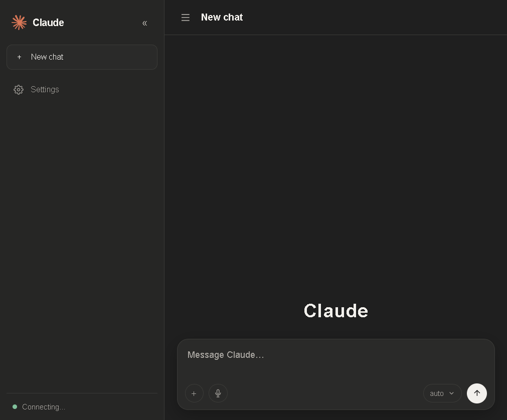
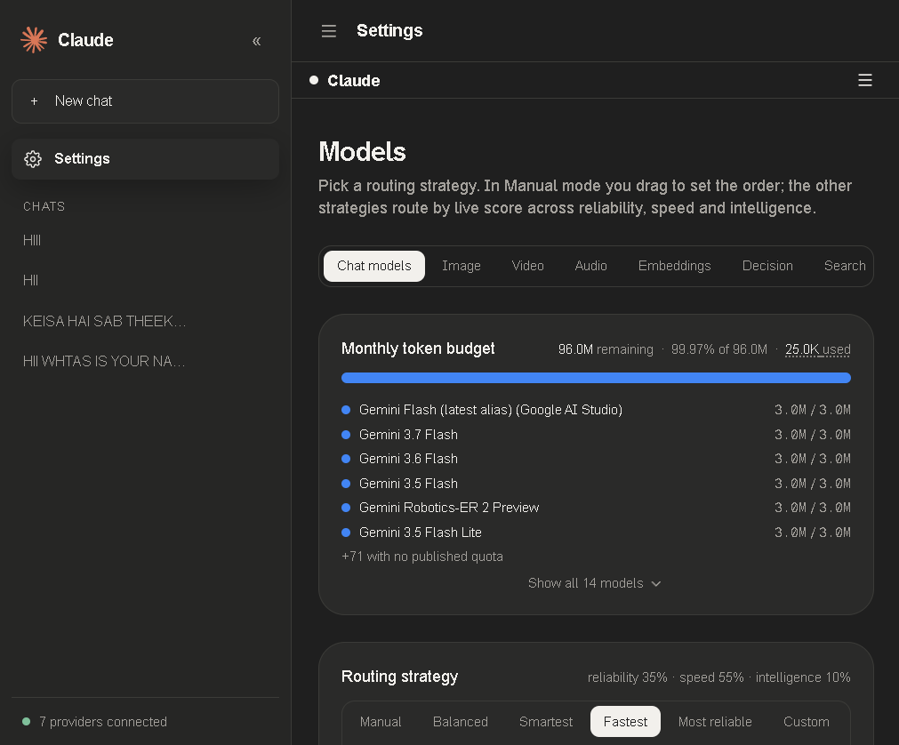

# Free Claude Code

Free Claude Code is a free, open-source Claude-style desktop chat app for Windows, built on the [FreeLLMAPI](https://github.com/tashfeenahmed/freellmapi) engine. Looking for a free Claude Code alternative for Windows? This build keeps the engine as it is and replaces the chat experience: dark/orange theme, Helvetica type, a real Claude-orange icon, chat history, mic dictation and a renameable chat heading.

> **Independent build.** It is not made by, affiliated with, or endorsed by Anthropic. "Claude" and "Claude Code" are trademarks of Anthropic PBC; the names are used here only to describe the look and feel of this interface.

## Download

| Platform | File | Notes |
| --- | --- | --- |
| Windows 10/11 (x64) | [ClaudeCode-Setup-0.16.34.exe](https://github.com/thecreativerihan-star/free-claude-code/releases/download/v0.16.34/ClaudeCode-Setup-0.16.34.exe) | One-click installer |
| Windows 10/11 (x64) | [Claude.Code-Portable-0.16.34.zip](https://github.com/thecreativerihan-star/free-claude-code/releases/download/v0.16.34/Claude.Code-Portable-0.16.34.zip) | Unzip and run `Claude Code.exe` — no install needed |

All builds: [Releases](https://github.com/thecreativerihan-star/free-claude-code/releases)

macOS, Linux and mobile: no binary is shipped here. The shell is Electron-based, so a Mac build is technically possible, but this project is currently packaged and tested for **Windows only**.

## Screenshots

## What you get

- **Claude-style chat** — dark workspace, orange accent, Helvetica UI, typing indicator, copy/regenerate actions and file attachments.
- **Chat history** — sidebar labelled "Chat history"; new chat, rename, delete and pin (up to 5). Chat titles are generated automatically.
- **Mic dictation** — speak instead of typing in the composer (Windows microphone permission required).
- **Custom chat heading** — `⋯ → Settings → General → Chat heading name`, type a name, press `Save`, wait for `Saved`. Only the heading of a brand-new chat changes; the sidebar and all other branding stay untouched.
- **Full dashboard still available** — `⋯ → Settings` opens the original dashboard with Models, Keys, Agents, Analytics and Premium. The Playground entry is hidden there because chatting happens in the main window.
- **Free provider routing** — the underlying FreeLLMAPI engine handles provider keys, failover and usage tracking.
- **Local data** — chats and keys stay on your PC in `%APPDATA%\FreeLLMAPI`.

## Install and first run (Windows)

1. Download the `.exe` installer, or the portable `.zip`.
2. Run the installer. If Windows SmartScreen appears, choose **More info → Run anyway** — this build is not code-signed.
3. Open **Free Claude Code**. On first launch go to `⋯ → Settings → Keys` and add a provider key, or pick one of the free providers exposed by the engine.
4. Return to the main chat window and start a new chat.

Portable version: unzip anywhere and run `Claude Code.exe`. It uses the same `%APPDATA%\FreeLLMAPI` data folder.

### Updating from old FreeLLMAPI

Uninstall the old `FreeLLMAPI` app first, then install this build. The data path is unchanged, so existing chats and keys keep loading.

### If something goes wrong

- **400 / 429 / 502 from a provider** — that model or provider is rate-limited or down; try a different model or provider. It is not an interface error.
- **Mic does not work** — allow microphone access to the app in Windows privacy settings.
- **SmartScreen warning** — expected for an unsigned installer; follow step 2.

## How it was built

This is an interface redesign, not a new engine written from scratch.

1. **Base engine** — FreeLLMAPI by Tashfeen Ahmed (MIT). Its documentation style was studied as a reference and this project's documentation was then written from scratch for this product.
2. **Chat UI** — a custom dark/orange dashboard lives in `client/scripts/claude-dashboard/` (`index.html`, `app.js`, `claude-theme.css`, `favicon.svg`).
3. **Build step** — `client/scripts/postbuild-extra.mjs` swaps the stock chat view for the custom one after the client build.
4. **Settings extension** — `client/src/components/settings-dialog.tsx` adds the `Chat heading name` field under General.
5. **Desktop shell** — `desktop/` packages the app with Electron and electron-builder using the orange icons in `desktop/assets/`, producing a Windows x64 NSIS installer and portable ZIP.

The `client/` and `desktop/` files in this repository are the interface files changed in this redesign. The complete upstream engine source stays at [tashfeenahmed/freellmapi](https://github.com/tashfeenahmed/freellmapi).

## Credits and license

- Original engine and MIT license: **Copyright (c) 2026 Tashfeen Ahmed**.
- Interface redesign, branding, packaging and documentation: **REHMAT ALI**, 2026.

Released under the MIT License — see [LICENSE](LICENSE). The trademark notice at the top of this file applies.
